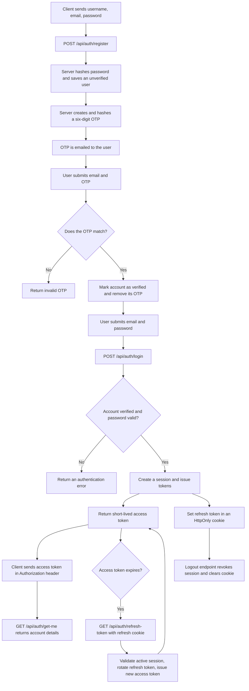

# Authentication API

A small Express and MongoDB authentication service. It supports account registration with email OTP verification, login, access-token refresh, and session logout.

## How authentication works

### Steps and purpose

1. **Register:** The server hashes the password, creates an unverified account, stores a hash of a generated OTP, and emails the OTP. Registration does not log the user in.
2. **Verify email:** The user submits the email and OTP. A match marks the account verified and removes its stored OTP, allowing login.
3. **Log in:** The server checks the account is verified and compares the submitted password hash. On success, it creates a session, returns an access token, and sets a refresh-token cookie.
4. **Use the account endpoint:** Send the access token in the `Authorization` header with the standard JWT token prefix to get the current account's username and email.
5. **Refresh:** When the access token expires, send the refresh cookie to get a new access token. The refresh token is rotated and its hash is updated in the session.
6. **Log out:** Revoke the current session and clear the refresh cookie. The logout-all endpoint is intended to revoke all of a user's sessions.

## API endpoints

All routes are prefixed with `/api/auth`.

| Method | Path | Purpose | Input / authentication |
|---|---|---|---|
| `POST` | `/register` | Create an account and send its verification OTP | JSON: `username`, `email`, `password` |
| `GET` | `/verify-email` | Verify an account using its OTP | Controller reads JSON body: `email`, `otp` |
| `POST` | `/login` | Log in to a verified account | JSON: `email`, `password` |
| `GET` | `/get-me` | Return the current user's username and email | `Authorization` header with access token and standard token prefix |
| `GET` | `/refresh-token` | Refresh tokens and rotate the refresh cookie | `refreshToken` cookie |
| `GET` | `/logout` | Revoke the current session and clear the refresh cookie | `refreshToken` cookie |
| `GET` | `/logout-all` | Intended to revoke all sessions and clear the refresh cookie | `refreshToken` cookie |

**Note:** `/verify-email` is currently registered as `GET`, although its controller reads `email` and `otp` from the request body. GET request bodies are not consistently supported by clients; consider changing this route to `POST` when wiring up a frontend. `/logout-all` is present, but its current controller implementation has a token-decoding error, so do not rely on it until that is fixed.

## Tokens and sessions

- **Access token:** JWT returned in the login/refresh response; expires after 15 minutes.
- **Refresh token:** JWT stored in an `HttpOnly`, `Secure`, `SameSite=Strict` cookie; expires after 7 days. It is rotated when refreshed.
- **Session record:** Stores the user's ID, a hash of the refresh token, request IP/user agent, and whether the session was revoked. Storing a hash allows logout to invalidate the session without storing the raw refresh token in the database.

## Run locally

1. Install dependencies with `npm install`.
2. Set the required environment variables in `.env`:
   - `MONGO_URI`
   - `JWT_SECRET`
   - `GOOGLE_CLIENT_ID`
   - `GOOGLE_CLIENT_SECRET`
   - `GOOGLE_REFRESH_TOKEN`
   - `GOOGLE_USER`
3. Start the server with `npm run dev`. It listens on port `3000`.

The Google OAuth values are used by Nodemailer to send verification emails. Keep all credentials and `.env` values private.
